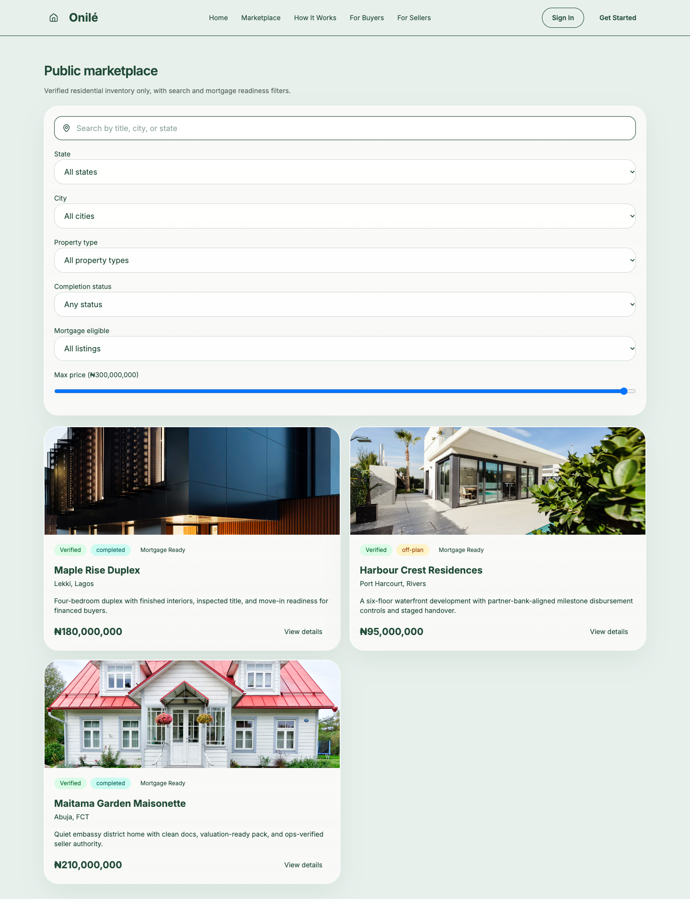

# Onilé — Property and Mortgage Workflow Demo

A frontend prototype for exploring a Nigerian property marketplace and the workflows around buying, listing, and financing a home. Buyers, sellers, and operations staff have separate workspaces backed by shared, seeded application state.



## Explore the demo

1. Start the app locally and browse `/marketplace` without signing in.
2. Open `/auth` and select a seeded demo account.
3. Explore saved properties, simulated savings, and mortgage applications in the buyer workspace.
4. Sign out and select a seller or admin account to explore listing and review workflows.

| Demo role | Email | Password |
| --- | --- | --- |
| Buyer | `amina@onileng.com` | `demo1234` |
| Self-employed buyer | `tunde@onileng.com` | `demo1234` |
| Seller | `seller@onileng.com` | `demo1234` |
| Admin | `admin@onileng.com` | `demo1234` |

These are fictional, public demo accounts defined in [the seed data](src/lib/seed.ts).

## Features

- Public marketplace with search, property filters, and listing details.
- Buyer workspace with saved properties, savings goals, and mortgage application steps.
- Multi-step onboarding with locally persisted drafts and document metadata.
- Seller workspace for property submissions and listing status.
- Admin workspace for onboarding, listing reviews, and application progression.
- Client-side role guards, notifications, and application audit history.

## Stack and architecture

React 19, TypeScript, Vite, Tailwind CSS, Zustand, React Router, React Hook Form, Zod, and Recharts. Vitest and Testing Library cover selected business rules and route guards.

Route components are lazy-loaded. Zustand holds shared state and persists it under the browser's `onile-ng-store` local storage key. Business rules are separate from page components so they can be tested directly.

## Run locally

Use Node.js 24 and npm. No backend or environment file is required.

```bash
git clone https://github.com/okikioriola1/onile-ng.git
cd onile-ng
npm ci
npm run dev
```

Open the URL printed by Vite. To restore the original seed state, remove the `onile-ng-store` entry from local storage for that origin and reload.

## Checks

```bash
npm run lint
npm test
npm run build
npm run preview
```

GitHub Actions runs lint, tests, and the production build on pushes and pull requests. Existing tests cover public listing visibility, search filters, mortgage eligibility, submission readiness, off-plan milestone requirements, route access, draft creation under Strict Mode, draft resumption, and mobile menu reset on navigation.

## Code map

- `src/App.tsx`: routes and role guards.
- `src/pages/`: public, authentication, buyer, seller, and admin screens.
- `src/store/useAppStore.ts`: persisted state and demo actions.
- `src/lib/business.ts`: workflow rules and selectors.
- `src/lib/seed.ts`: fictional users, properties, applications, and credentials.
- `src/types.ts`: shared domain types.

## Demo boundaries

Authentication, bank accounts, deposits, KYC reviews, and mortgage decisions are simulated in the browser. Route guards demonstrate navigation behavior; they do not provide server-side authorization. Uploaded documents are represented by filenames and metadata, rather than stored files. Explore with fictional details because application state, including account details, is stored locally.

## Next improvements

Add authenticated backend APIs, server-side permissions, real integrations, and end-to-end coverage for onboarding and mortgage review. Expand keyboard and mobile usability checks across each role.
